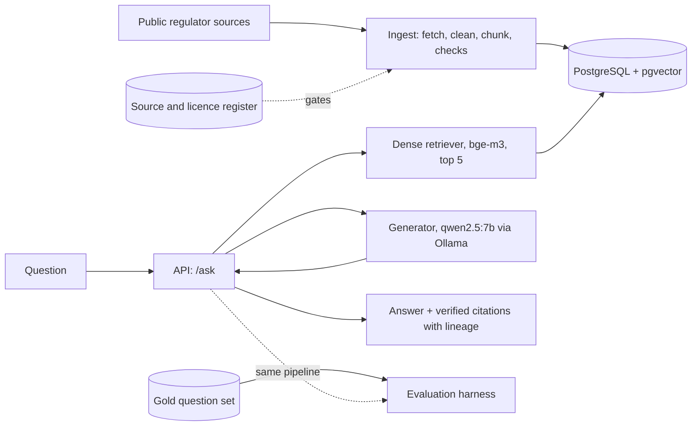

# bfs-reg-copilot

A governed retrieval-augmented assistant that helps compliance and operations staff find which
Canadian or US financial-regulation requirement applies to a question, with citations to the
exact source section. Built to the engineering and governance patterns used in banks, on
**public data only**.

> **Honest scope.** This is a learning and portfolio project. It is built to production
> patterns (infrastructure as code, CI/CD, evaluation gates, monitoring, model-risk
> documentation) but it has **not** been deployed in a regulated institution, and it is **not**
> legal or compliance advice. Answers must be verified against the cited primary source.

## Status

| Phase | Goal | Status |
|---|---|---|
| 0. Frame and govern | Concept brief, metrics, risk register, source register, ADRs, repo baseline | Complete |
| 1. Data pipeline | Acquire, parse, chunk and index the documents | Complete |
| 2. Baseline RAG and evaluation | Stock model, gold question set, first measured scores | Complete (tag `phase-2-complete`) |
| 3. Improve | Hybrid retrieval, reranking, abstention, optional fine-tuning | Ready to start |
| 4. Productionise | Terraform, Kubernetes, CI/CD, monitoring on Azure Canada Central | Not started |
| 5. Shadow pilot and operate | Simulated pilot, model card, inventory entry, runbook, demo | Not started |

Start with [`docs/00-index.md`](docs/00-index.md).

## First measured result (baseline, dev split)

A deliberately plain pipeline: dense retrieval (bge-m3), the top five passages, a local
`qwen2.5:7b` model, no safeguards beyond the prompt. It is the starting point that every later
change is judged against, not a finished product.

| Metric | Result | Target at the final gate |
|---|---|---|
| M1 cited-answer accuracy | 24 of 32 (75%, 95% interval 58% to 87%) under gold v2; 22 of 32 under v1 before two rubric corrections | 90% or more |
| M2 correct refusal | 12 of 12 (100%, interval 76% to 100%) | 90% or more |
| M4 retrieval hit@5 | 30 of 32 (94%) | 90% or more (proposed) |
| M5 fabricated citations | 0 of 46 | 1% or less |

These are measured on 47 development questions, so the intervals are wide. The hold-out
questions are sealed and have not been run. The main weakness is incomplete answers: the system
quotes the top passage faithfully but often misses points held in other passages. Two answers
were wrong. Full record, failure analysis and limits:
[`docs/17-baseline-v1.md`](docs/17-baseline-v1.md). The Phase 2 gate review and the decisions taken
at it are in [`docs/20-gate-3-phase-2-review.md`](docs/20-gate-3-phase-2-review.md).

CI checks that the measuring instrument works and that this record stays consistent with the gold
set. It does not measure answer quality, because CI has no model
([`docs/19-ci-evaluation.md`](docs/19-ci-evaluation.md)).

## What is built



Planned, not built: hybrid retrieval and reranking, refusal thresholds, authentication,
Terraform and Kubernetes deployment, observability, and a hosted model on Azure Canada Central.
The choices and the alternatives rejected are recorded in [`docs/adr/`](docs/adr/).

## Quick start

Requires Python 3.12+ and [uv](https://docs.astral.sh/uv/). Every command below runs as
`uv run python -m ...`, which also works on machines that block executable launchers.

```bash
make setup     # install dependencies and git hooks
make check     # lint, type-check, test, validate the source register
make register  # print the source register summary
```

`make check` needs no database and no model. The steps below build the corpus and run the
assistant on your own machine. They need Docker (for PostgreSQL) and
[Ollama](https://ollama.com) with the models `bge-m3` and `qwen2.5:7b`.

```bash
make db-up                                          # local PostgreSQL with pgvector
uv run python -m bfs_reg_copilot.ingest fetch <source_id>   # then clean, chunk, dq (doc 10)
uv run python -m bfs_reg_copilot.store migrate
uv run python -m bfs_reg_copilot.store load
uv run python -m bfs_reg_copilot.store embed --model bge-m3
uv run python -m bfs_reg_copilot.api                # http://127.0.0.1:8000/docs
```

Reproduce the baseline measurement on the development questions (about 11 minutes):

```bash
uv run python -m bfs_reg_copilot.eval run --pipeline baseline --split dev
```

Details: ingest [`docs/10`](docs/10-orchestration.md), database [`docs/14`](docs/14-database.md),
retrieval [`docs/15`](docs/15-retrieval.md), generator [`docs/16`](docs/16-generator.md),
API [`docs/18`](docs/18-api.md), evaluation [`docs/13`](docs/13-evaluation-harness.md).

The API has no authentication and listens only on `127.0.0.1`.

## Repository layout

```
docs/            governance documents and architecture decision records (ADRs)
data/sources/    source and licence register (YAML, validated in CI)
dags/            the Airflow ingest pipeline
src/             application code: ingest, store, embed, retrieve, gateway, rag, api, eval
tests/           automated tests (the database tests run when BFS_TEST_DATABASE_URL is set)
eval/gold/       the gold question sets (v1 and v2; a hold-out is sealed in code)
eval/baselines/  recorded baseline grades and manifest, without any source text
.github/         CI, security scanning, issue and pull request templates
```

## Sources, terms and attribution

The regulatory documents this project reads belong to their publishers. **No corpus text is
committed to this repository.** The register lists each source, its terms, and whether it may be
ingested. Where terms require it, answers show the document title, issuer, original URL and
retrieval date. See [`docs/05-data-statement.md`](docs/05-data-statement.md).

## Licence

Code and original documentation: [Apache-2.0](LICENSE). Third-party source documents keep their
publishers' terms.
