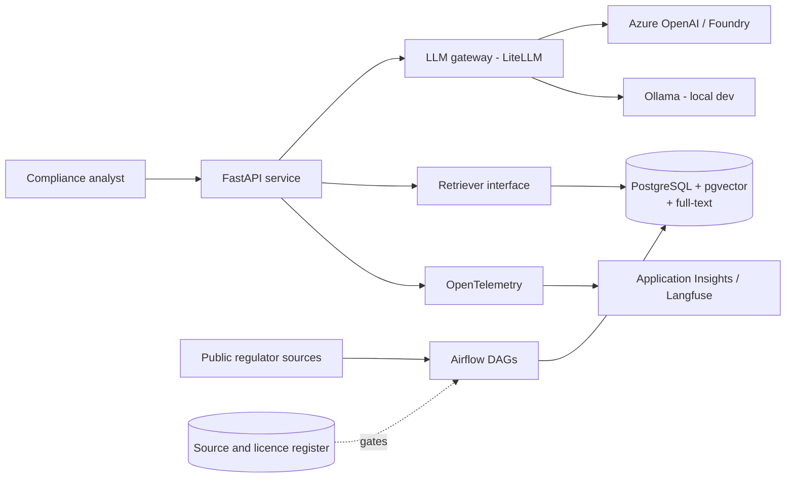

# bfs-reg-copilot

A governed retrieval-augmented assistant that helps compliance and operations staff find which
Canadian or US financial-regulation requirement applies to a question, with citations to the
exact source section. Built to the engineering and governance patterns used in banks, on
**public data only**.

> **Honest scope.** This is a learning and portfolio project. It is built to production
> patterns (infrastructure as code, CI/CD, evaluation gates, monitoring, model-risk
> documentation) but it has **not** been deployed in a regulated institution, and it is **not**
> legal or compliance advice. Answers must be verified against the cited primary source.

## Status

| Phase | Goal | Status |
|---|---|---|
| 0. Frame and govern | Concept brief, metrics, risk register, source register, ADRs, repo baseline | In review |
| 1. Data pipeline | Acquire, parse, chunk and index the documents | Not started |
| 2. Baseline RAG and evaluation | Stock model, gold question set, first measured scores | Not started |
| 3. Improve | Hybrid retrieval, reranking, abstention, optional fine-tuning | Not started |
| 4. Productionise | API, Terraform, Kubernetes, CI/CD, monitoring on Azure Canada Central | Not started |
| 5. Shadow pilot and operate | Simulated pilot, model card, inventory entry, runbook, demo | Not started |

Start with [`docs/00-index.md`](docs/00-index.md).

## Target architecture



Choices and alternatives are recorded in [`docs/adr/`](docs/adr/).

## Quick start

Requires Python 3.12+ and [uv](https://docs.astral.sh/uv/).

```bash
make setup     # install dependencies and git hooks
make check     # lint, type-check, test, validate the source register
make register  # print the source register summary
```

## Repository layout

```
docs/            governance documents and architecture decision records (ADRs)
data/sources/    source and licence register (YAML, validated in CI)
src/             application code
tests/           automated tests
eval/            gold question set and evaluation harness (from Phase 2)
.github/         CI, security scanning, issue and pull request templates
```

## Sources, terms and attribution

The regulatory documents this project reads belong to their publishers. **No corpus text is
committed to this repository.** The register lists each source, its terms, and whether it may be
ingested. Where terms require it, answers show the document title, issuer, original URL and
retrieval date. See [`docs/05-data-statement.md`](docs/05-data-statement.md).

## Licence

Code and original documentation: [Apache-2.0](LICENSE). Third-party source documents keep their
publishers' terms.
